<!-- ============ HEADER ============ -->
<div align="center">


</div>

<br>

<!-- ============ MASCOT + TERMINAL ============ -->
<!-- CATATAN: kalau maskot hilang, ganti src di bawah sesuai lokasi file SVG kamu di repo -->
<table align="center">
<tr>
<td width="280" align="center">
  
</td>
<td>

```bash
┌──(hadzxcode㉿cat-bot)-[~]
└─$ cat about.txt

  Name     : Jihad Al Qudsi
  Username : hadzxcode
  Role     : Frontend Developer
  Study    : Information Systems
  Learning : Java ☕
  Motto    : "Clean code, creative design,
              continuous learning."

└─$ _
```

</td>
</tr>
</table>

<br>

<!-- ============ TECH STACK ============ --> <div align="center">   <br>        </div> <br>

<!-- ============ FEATURED PROJECT ============ -->
<div align="center">


</div>

```bash
┌──(hadzxcode㉿cat-bot)-[~/projects/sorsinggih]
└─$ ./info.sh

  [ PROJECT ]  Anu bang 
  [ ABOUT   ] Anu pokoknya
  [ STACK   ]  Anu
  [ STATUS  ]  ● ONLINE — still building, still improving

└─$ _
```

<br>


<!-- ============ FOOTER ============ -->
<div align="center">


</div>
